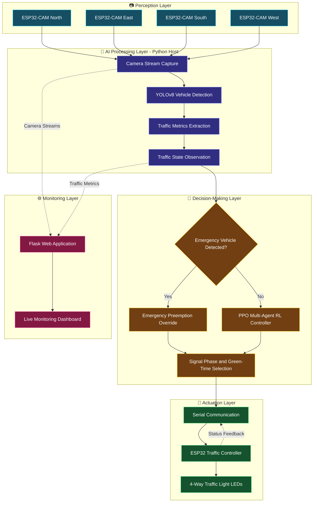

# 🚦 AI-Based Traffic Control System

<p align="center">
  
</p>

<p align="center">
  An intelligent traffic management system that combines Computer Vision, Multi-Agent Reinforcement Learning, and IoT hardware to optimize traffic signals dynamically and prioritize emergency vehicles.
</p>

<p align="center">
  
  
  
  
  
</p>

---

## 📌 Overview

Traditional traffic signal systems often rely on fixed timing schedules that cannot respond effectively to changing traffic conditions.

This project introduces an **AI-powered adaptive traffic control system** that detects vehicles, analyzes traffic conditions, and dynamically adjusts signal timings using Reinforcement Learning. It also supports emergency vehicle prioritization and physical traffic light control through ESP32 hardware.

The system integrates camera-based perception, intelligent decision-making, traffic simulation, and IoT-based actuation into a unified architecture.

## ✨ Key Features

- 🚗 **Real-Time Vehicle Detection** — Detect vehicles using YOLOv8.
- 📊 **Traffic Density Estimation** — Analyze vehicle counts and queue lengths to understand traffic conditions.
- 🧠 **Adaptive Signal Control** — Use a Proximal Policy Optimization (PPO) agent to determine traffic signal timings.
- 🤖 **Multi-Agent Reinforcement Learning** — Coordinate multiple traffic agents using a shared policy.
- 🚑 **Emergency Vehicle Priority** — Override normal signal control to prioritize detected emergency vehicles.
- 🚦 **Physical Traffic Light Control** — Communicate with an ESP32 controller to operate traffic light LEDs.
- 🌐 **Live Monitoring Dashboard** — Visualize traffic streams and real-time system metrics.
- 🧪 **Traffic Simulation** — Use SUMO to model and evaluate traffic scenarios.

## 🛠️ Tech Stack

<p align="center">
  
  
  
  
  
  
  
  
  
  
  
  
  
  
  
  
</p>

| Category | Technologies |
|---|---|
| Programming | Python |
| Computer Vision | YOLOv8, OpenCV |
| Reinforcement Learning | PPO, Stable-Baselines3, Multi-Agent RL |
| Simulation | SUMO |
| Backend | Flask, Python |
| Frontend | HTML5, CSS3, JavaScript |
| Hardware | ESP32-CAM, ESP32 Development Board |
| Communication | Wi-Fi, HTTP, Serial Communication, MQTT (where configured) |
| Development Tools | VS Code, Git, GitHub |

## 🏗️ System Architecture

The AI-Based Traffic Control System follows a modular **Perception → Intelligence → Decision → Actuation** architecture, integrating computer vision, Multi-Agent Reinforcement Learning (MARL), IoT hardware, and a live monitoring dashboard.

### Architecture Diagram



### Architecture Components

| Layer | Components | Responsibility |
|---|---|---|
| Perception | ESP32-CAM devices | Capture traffic footage from four intersection approaches |
| AI Processing | Python, YOLOv8 | Detect vehicles and extract traffic-related metrics |
| Decision-Making | PPO, Multi-Agent RL | Select adaptive signal actions based on observed traffic conditions |
| Emergency Handling | Emergency detection and priority override | Prioritize detected emergency vehicles according to the configured control logic |
| Actuation | Serial communication, ESP32, LEDs | Send signal commands and control physical traffic lights |
| Monitoring | Flask, web dashboard | Display available camera streams and real-time traffic metrics |

### System Workflow

1. **Capture:** Camera streams provide traffic frames to the Python host.
2. **Detect:** YOLOv8 identifies vehicles and supported emergency vehicle classes.
3. **Analyze:** The system extracts traffic observations, such as vehicle counts and queue lengths.
4. **Decide:** The emergency-handling logic selects either the priority override or the PPO-based control path.
5. **Actuate:** The selected signal command is transmitted to the ESP32 controller.
6. **Monitor:** The Flask dashboard presents available video streams and traffic metrics.

### Simulation and Reinforcement Learning

The system also uses **SUMO** to simulate traffic scenarios and evaluate adaptive traffic control. The PPO-based multi-agent setup uses a shared policy across the configured traffic agents.

<p align="center">
  
</p>

*Optional: Replace the image above with your PPO training reward graph, SUMO simulation screenshot, or traffic performance comparison.*

> **Implementation note:** This diagram represents the intended high-level architecture. Update the communication paths and components to match your actual implementation—for example, include MQTT only where it is genuinely used, and show SUMO as a separate simulation environment if it is not directly connected to the physical controller during live operation.


### 🔄 Workflow

1. **Data Capture:** ESP32-CAM devices capture traffic footage from different approaches.
2. **Vehicle Detection:** YOLOv8 processes frames to detect vehicles and supported emergency vehicle classes.
3. **Traffic Analysis:** The system derives traffic metrics such as vehicle counts and queue lengths.
4. **Intelligent Decision-Making:** The PPO-based multi-agent controller selects signal actions based on the observed traffic state.
5. **Emergency Preemption:** Emergency detection triggers the configured priority override.
6. **Signal Actuation:** The Python controller communicates with the ESP32 to control physical traffic light LEDs.
7. **Live Monitoring:** The dashboard displays available camera streams and traffic metrics.

## 🖥️ Project Screenshots

Showcase the most important parts of your system here.

### Live Traffic Monitoring Dashboard

<p align="center">
  
</p>

### Vehicle Detection with YOLOv8

<p align="center">
  
</p>

### Emergency Vehicle Priority

<p align="center">
  
</p>

### Physical Traffic Light Prototype

<p align="center">
  
</p>

## 🎬 Demo Videos

### Full System Demonstration

[▶ Watch the full project demonstration](YOUR_FULL_DEMO_VIDEO_URL)

<!-- Optional: Embed a YouTube video preview using its thumbnail. -->

<p align="center">
  <a href="YOUR_FULL_DEMO_VIDEO_URL">
    
  </a>
</p>

### Additional Demonstrations

- **Vehicle Detection:** [Watch Demo](YOUR_VEHICLE_DETECTION_VIDEO_URL)
- **Adaptive Signal Control:** [Watch Demo](YOUR_SIGNAL_CONTROL_VIDEO_URL)
- **Emergency Vehicle Priority:** [Watch Demo](YOUR_EMERGENCY_PRIORITY_VIDEO_URL)
- **Hardware Integration:** [Watch Demo](YOUR_HARDWARE_DEMO_VIDEO_URL)

> Replace the example links with your actual YouTube, Google Drive, or other publicly accessible video URLs.

## 📂 Repository Structure

```text
AI-Based-Traffic-Control-System/
│
├── docs/
│   └── images/
│       ├── project-banner.png
│       ├── system-architecture.png
│       ├── dashboard.png
│       ├── vehicle-detection.png
│       ├── emergency-priority.png
│       ├── hardware-prototype.jpg
│       └── demo-thumbnail.png
│
├── models/                 # Trained model files, if included
├── static/                 # Dashboard assets, if applicable
├── templates/              # Flask HTML templates, if applicable
├── *.py                    # Python application modules
├── requirements.txt        # Python dependencies
├── README.md
└── .gitignore
```

> Adjust this structure to match the actual folders and files in your repository. Avoid committing large model weights or generated datasets unless necessary.

## ⚙️ Getting Started

### Prerequisites

Install or configure the following:

- Python (version compatible with your dependencies)
- Git
- SUMO and its Python tools
- A compatible YOLOv8 model and required model weights
- ESP32 development environment, if using physical hardware

### Installation

**1. Clone the repository**

```bash
git clone YOUR_GITHUB_REPOSITORY_URL
cd AI-Based-Traffic-Control-System
```

**2. Create a virtual environment**

```bash
python -m venv venv
```

Activate it on Windows:

```powershell
.\venv\Scripts\Activate.ps1
```

**3. Install dependencies**

```bash
pip install -r requirements.txt
```

**4. Configure the environment**

Update the configuration values required by your project, including camera stream addresses, serial port, model paths, and SUMO configuration.

Do not commit credentials, private network details, or other sensitive configuration values.

**5. Run the application**

```bash
python app.py
```

> Use the actual entry point and commands from your project. If your application starts through `traffic_system.py` or requires SUMO to be running first, update these instructions accordingly.

## 🔌 Hardware Setup

The physical implementation uses ESP32-based hardware to connect camera capture and traffic signal control with the Python application.

| Component | Purpose |
|---|---|
| ESP32-CAM | Capture traffic footage |
| ESP32 Development Board | Control traffic light outputs |
| Traffic Light LEDs | Represent intersection signal states |
| Laptop / Host Computer | Run vehicle detection, RL control, and monitoring |
| USB Serial Connection | Exchange control commands and status messages |

<p align="center">
  
</p>

**Important:** Verify the GPIO mapping, serial protocol, and signal transition logic against your actual hardware implementation before running the controller.

## 📊 Results and Evaluation

Use this section to present measured results from your SUMO simulations or hardware tests.

| Metric | Result |
|---|---|
| Average Waiting Time | `ADD MEASURED RESULT` |
| Average Queue Length | `ADD MEASURED RESULT` |
| Average Vehicle Throughput | `ADD MEASURED RESULT` |
| Emergency Detection Performance | `ADD MEASURED RESULT` |
| Comparison with Fixed-Time Signals | `ADD MEASURED RESULT` |

<p align="center">
  
</p>

> Include only results you have measured. Document the simulation settings, test duration, traffic demand, and baseline used for fair comparison.

## 🚀 Future Enhancements

- Improve coordination between neighboring intersections.
- Expand emergency vehicle detection and priority handling.
- Evaluate the controller under different traffic demand scenarios.
- Add historical analytics and performance visualizations to the dashboard.
- Improve fault handling and communication reliability between the host and ESP32.
- Evaluate the system under larger simulated road networks.

## 🤝 Contributing

Contributions, suggestions, and improvements are welcome.

1. Fork the repository.
2. Create a feature branch.
3. Commit your changes.
4. Open a pull request describing your contribution.

## 📜 License

This project is currently provided for educational and research purposes.

Choose and add an appropriate open-source license before permitting reuse. For example, you can add an MIT License by creating a `LICENSE` file.

## 👨‍💻 Author

**Midhun Kunjumon**

B.Tech in Computer Science and Engineering — Artificial Intelligence and Machine Learning

- GitHub: [YOUR_GITHUB_USERNAME](YOUR_GITHUB_PROFILE_URL)
- LinkedIn: [YOUR_LINKEDIN_PROFILE](YOUR_LINKEDIN_PROFILE_URL)

---

<p align="center">
  If you find this project interesting, consider giving the repository a ⭐
</p>
